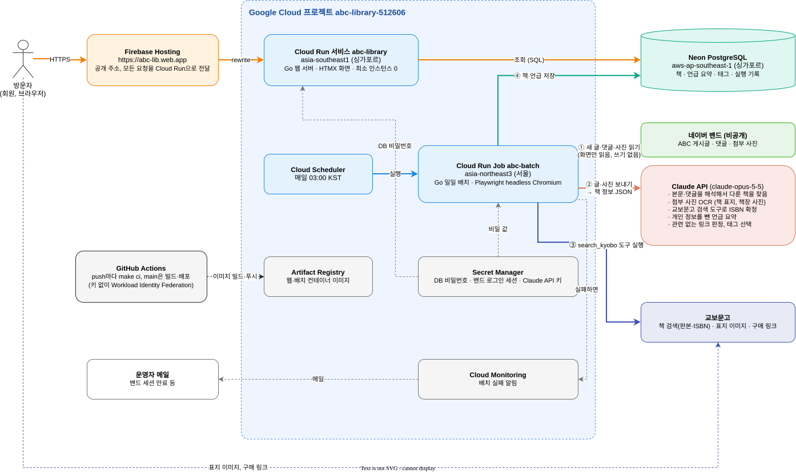

# ABC 도서관 인프라 구성

아카라카북클럽(ABC) 밴드에 올라온 글에서 AI가 책을 찾아 정리하고, 그 결과를 웹사이트 https://abc-lib.web.app 에 보여 준다.

## 구성 요소의 역할

| 구성 요소 | 역할 |
|---|---|
| Firebase Hosting | 공개 주소 `abc-lib.web.app`을 제공한다. 받은 요청을 모두 Cloud Run 웹 서비스로 넘긴다. 응답은 캐시하지 않으므로 DB가 바뀌면 바로 보인다. |
| Cloud Run 서비스 `abc-library` | 웹 서버다. 싱가포르 리전에서 Neon DB를 조회해서 책, 저자, 태그, 최근 소식 화면을 그린다. 요청이 없으면 인스턴스가 0개로 줄어든다. |
| Cloud Scheduler | 매일 03:00(KST)에 배치 Job을 실행한다. |
| Cloud Run Job `abc-batch` | 일일 배치다. 서울 리전에서 돌아서 밴드 로그인 세션이 한국 IP에서 쓰인다. 밴드를 읽고, Claude로 책 정보를 뽑고, DB에 저장한다. |
| Secret Manager | DB 비밀번호, 밴드 로그인 세션 파일, Claude API 키를 보관한다. 코드와 이미지에는 비밀 값이 없다. |
| Artifact Registry | GitHub Actions가 빌드한 웹·배치 컨테이너 이미지를 보관한다. 최근 5개만 남긴다. |
| Cloud Monitoring | 배치 Job이 실패하면 운영자에게 메일을 보낸다. 밴드 세션이 만료되면 배치가 실패하므로 이 메일로 알 수 있다. |
| Neon PostgreSQL | 책, 언급 요약, 태그, 배치 실행 기록을 저장한다. 밴드 글의 원문과 작성자는 저장하지 않는다. |
| 네이버 밴드 | 정보의 원천이다. 비공개 밴드라서 사람이 한 번 로그인해 둔 세션으로 화면을 읽기만 한다. 글쓰기, 댓글 같은 쓰기 동작은 하지 않는다. |
| Claude API | 글을 해석해서 책 정보를 찾는다. 자세한 내용은 아래 'AI가 하는 일'에 있다. |
| 교보문고 | 책을 검색해서 판본과 ISBN을 확정한다. 화면의 표지 이미지와 구매 링크도 교보문고로 통일한다. |
| GitHub Actions | push마다 린트와 테스트(`make ci`)를 돌리고, `main`에 push하면 이미지를 빌드해서 배포한다. 서비스 계정 키 없이 Workload Identity Federation으로 GCP에 인증한다. |

## 흐름

### 화면 요청

1. 방문자가 `abc-lib.web.app`에 접속하면 Firebase Hosting이 요청을 Cloud Run 웹 서비스로 넘긴다.
2. 웹 서비스가 Neon에서 책과 언급을 읽어 HTML을 그린다. '더 보기' 같은 상호작용은 HTMX가 HTML 조각만 다시 받아서 바꾼다.
3. 표지 이미지는 브라우저가 교보문고에서 직접 받는다. 구매 링크도 교보문고 상품 페이지로 간다.

### 일일 배치

1. Cloud Scheduler가 매일 03:00에 Job을 실행한다.
2. Job이 Playwright(headless Chromium)로 밴드에 접속해서 새 글, 처리하지 못한 글, 최근 7일 사이 바뀐 글을 읽는다. 본문, 댓글, 링크, 첨부 사진을 모은다.
3. 내용이 바뀐 글만 Claude에 보낸다. Claude가 책을 찾고, 교보문고 검색 도구로 ISBN을 확정하고, 언급 요약을 만든다.
4. 코드가 결과를 검증해서 Neon에 저장한다. 실행 기록도 남긴다.
5. 실패하면 Cloud Monitoring이 메일을 보낸다. 처리하지 못한 글은 다음 날 최대 5번까지 다시 시도한다.

## AI가 하는 일

배치는 게시글 하나마다 Claude(`claude-opus-5-5`)에 본문, 댓글, 링크, 첨부 사진을 함께 보낸다.
Claude는 정해진 JSON 스키마(structured outputs)로 답한다.

- **본문 해석**: 추천, 감상, 읽는 중인 책처럼 글이 실제로 다룬 책을 고른다. 《 》, 『 』로 감싼 제목은 지나가듯 언급해도 책으로 본다. 영화나 드라마처럼 책이 아닌 작품은 뺀다.
- **사진 OCR**: 첨부 사진(글마다 최대 4장)에서 책 표지와 책장에 꽂힌 책의 제목, 저자를 읽어서 책을 찾는다. 글에 제목이 없어도 사진만으로 찾을 수 있다.
- **링크 해석**: 링크 제목과 주소도 근거로 쓴다. 제목 없는 독서 기록 링크(`/연희동-러너/` 같은 주소)에서도 책을 알아본다.
- **댓글 판정**: 댓글이 본문의 책에 대한 것인지, 댓글에서 새로 소개한 다른 책에 대한 것인지 가린다.
- **ISBN 확정**: Claude가 `search_kyobo` 도구를 부르면 배치 코드가 교보문고를 검색해서 결과를 돌려준다. Claude는 그중 맞는 판본을 고른다. 시리즈는 특정 권을 언급하면 그 권을, 권 언급이 없으면 합본이나 세트를, 그것도 없으면 1권을 고른다.
- **언급 요약**: 그 글이 책에 대해 한 이야기를 요약한다. 회원의 이름, 학번, 직장, 사적인 경험담 같은 개인 정보는 뺀다.
- **링크 판정**: 언급에 들어 있던 링크 중 그 책과 직접 관련 없는 것(지도, 행사 안내, 다른 주제의 기사)을 가려낸다.
- **태그 선택**: 정해진 목록에서 모임 주제(AI, SF, 과학)와 갈래(소설, 인문 등) 태그를 고른다.

Claude의 답을 그대로 믿지 않고 코드가 검증한다.

- 교보문고 검색 결과에 실제로 있었던 ISBN만 받아들인다.
- 정해진 목록에 없는 태그는 버린다. SF 책에는 과학 태그를 붙이지 않는다.
- 링크는 코드가 모두 붙이고, Claude가 관련 없다고 판정한 링크와 서점 구매 링크만 뺀다.
- Claude가 처리를 거절하면 그 글을 책 없이 저장해서 매일 다시 보내지 않는다.

## 기술 스택

### 애플리케이션

- **Go 1.27**: 웹 서버(`cmd/web`)와 일일 배치(`cmd/batch`)
- **웹 화면**: 표준 라이브러리 `net/http`와 `html/template`으로 서버에서 HTML을 그린다. 상호작용은 **HTMX**로 처리하고, SPA 프레임워크나 JS 빌드 도구는 쓰지 않는다. 템플릿과 정적 파일은 바이너리에 포함한다.
- **DB 접근**: **Bun** ORM과 pgx 드라이버로 PostgreSQL에 접근한다. 스키마는 Bun 마이그레이션 파일로 관리하고, 배치가 실행될 때 적용한다.
- **밴드 수집**: **playwright-go**로 headless Chromium을 띄워 밴드 웹 화면을 읽는다.
- **AI**: 공식 Go SDK **anthropic-sdk-go**로 Claude Messages API를 부른다. 도구 사용(tool use)으로 교보문고를 검색하고, structured outputs로 JSON 결과를 받는다.

### 인프라와 운영

- **컨테이너**: 웹은 distroless 이미지에 Go 바이너리 하나만 담는다(약 7MB). 배치는 Ubuntu에 Chromium headless shell만 설치해서 이미지를 줄였다(약 340MB).
- **Google Cloud**: Cloud Run(서비스, Job), Cloud Scheduler, Secret Manager, Artifact Registry, Cloud Monitoring
- **Firebase Hosting**: 짧은 공개 주소
- **Neon**: 서버리스 PostgreSQL
- **GitHub Actions**: CI와 배포. GCP 인증은 Workload Identity Federation으로 한다.
- **품질 도구**: golangci-lint(린트, 포맷), `go test`. 외부 서비스는 인터페이스 뒤에 두고 가짜 구현으로 단위 테스트한다. 실제 Claude와 교보문고를 부르는 테스트는 `integration` 빌드 태그로 따로 돌린다.

배포 절차와 설정 값은 `docs/spec.md`의 '배포'와 `scripts/gcp-env.sh`에 있다.
